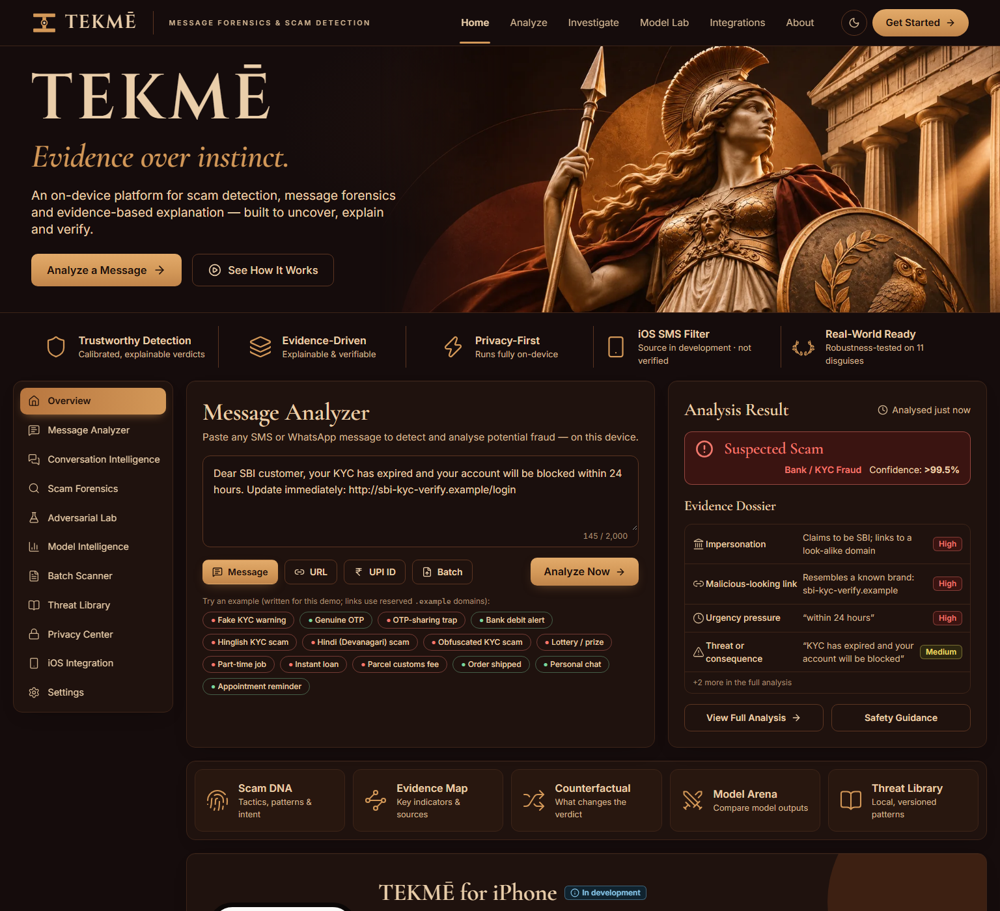
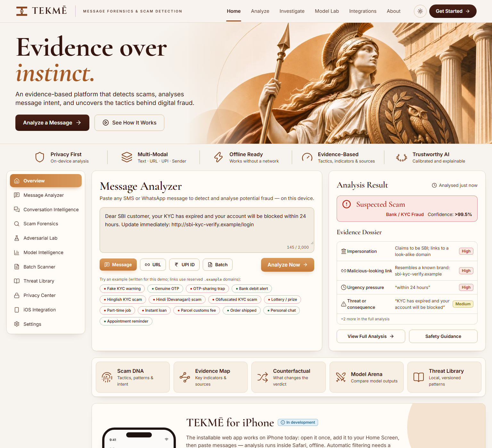

# TEKMĒ — Evidence over instinct.

**An offline, evidence-based scam-message detector that runs on your device.**
Tinyverse — Problem Statement 01: On-Device Scam Message Detector · Divya Ramji (USN 1MS24CI044) · formerly *SCAMPRINT*

Paste one SMS or WhatsApp message. TEKMĒ returns **SCAM / SAFE** (or **UNCERTAIN** when the evidence is mixed), a
**category** (KYC / Bank, Lottery / Prize, Loan / Credit, Job / Investment, Other), a **calibrated confidence**, the
**manipulation tactics** it found, link / payment / brand **forensics**, a plain-language **explanation** (English or
Hinglish) and **what to do next** — computed by a model that runs inside your browser. The message never leaves the device.

| Dark | Light |
|---|---|
|  |  |

## What it does
* **Detects the strategy, not just keywords** — Scam DNA identifies 10 tactics (urgency, threats, impersonation,
  rewards, OTP/PIN requests, payments, link pushing, job/investment lures, emotional pressure, secrecy).
* **Protects genuine messages** — OTP, bank-alert, delivery and reminder shapes; a conflict detector catches
  "genuine-looking notification + malicious instruction" (e.g. *share the OTP with our agent*).
* **Calibrated** — confidence is the calibrated probability of the predicted verdict (test ECE 0.007).
* **Robust to disguise** — look-alike Unicode, digit swaps, spaced letters, invisible characters, SMS
  abbreviations and Hinglish are normalised; evidence is highlighted in the original text.
* **Investigates** — offline link forensics (punycode, credentials-before-@, IPs, look-alikes, shorteners,
  redirects, downloads), UPI/payment fraud patterns, brand-claim analysis, sender-ID checks, evidence timeline,
  similarity to local scam families.
* **Goes further** — conversation escalation analysis, counterfactual sensitivity tests, Mutation Lab, Model
  Battle Arena, batch scanning with redacted export, a versioned local threat library, privacy audit, feedback
  stored locally (never silently retrained), accessibility settings, installable offline web app.

Everything marked as done in [FEATURE_MATRIX.md](FEATURE_MATRIX.md) is implemented and tested; what is not is
labelled there.

## Results (computed by the evaluation scripts — never typed in)

| Held-out test split (n = 3,138) | | External Test B (n = 400) | |
|---|---|---|---|
| Accuracy | **95.0 %** | Accuracy | 88.5 % |
| Precision / recall | 95.4 % / 93.7 % | F1 / false-positive rate | 0.882 / 9.5 % |
| False-positive rate | **3.9 %** | "Hard" subset accuracy | 77.1 % |
| ROC-AUC · Brier · ECE | 0.988 · 0.038 · 0.007 | 11,000 disguised messages | 94.7 % |
| Category macro-F1 | 0.849 | Genuine OTPs flagged | 0 / 58 |

* **Browser ⇄ Python parity** (5,072 messages): verdict, category, tactics, signals, explanation and highlights
  identical on every message; largest probability difference 3.6 × 10⁻⁶ ([docs/PARITY.md](docs/PARITY.md)).
* **Speed** (this laptop, in V8): 5.6 ms median / 11.2 ms p95 per full analysis; model file 6.6 MB (3.5 MB gzip).
* **Limits that matter:** 41 % of the data is LLM-generated and genuine *service* messages are almost all
  synthetic, so the real-world false-positive rate is not directly measured; Hinglish/Hindi data is small.

## Quick start (Windows, PowerShell)
```powershell
.\setup.ps1      # one time: Python venv + packages, npm install, production build (needs internet once)
.\run.ps1        # serve on http://127.0.0.1:8000 — the model runs in your browser, offline
.\test.ps1       # Python tests + frontend tests (parity, behaviour, UI, accessibility) + build + offline scan
```
Rebuild everything from the public data (~20 min CPU): `.\scripts\train_all.ps1`. Hot-reload UI: `.\run.ps1 -Dev`.
Full guide: [docs/SETUP_WINDOWS.md](docs/SETUP_WINDOWS.md) · problems: [docs/TROUBLESHOOTING.md](docs/TROUBLESHOOTING.md).

## On iPhone
* **Today:** the installable web app runs the same on-device engine in Safari (paste messages; works offline once
  cached). It needs to be served over HTTPS once — see [docs/IOS_GUIDE.md](docs/IOS_GUIDE.md).
* **In development, not verified:** `ios/` contains a SwiftUI app and an IdentityLookup **Message Filter
  extension** (unknown-sender SMS only, fully on-device). It has never been compiled — that needs a Mac with Xcode.
  Nothing filters your messages automatically today.

## Architecture
```
Python (training, evaluation, reference)                Browser (runtime, on-device)
 data → preprocess → rules → TF-IDF LR → fusion  ──export──►  model.bin + rules.json → same pipeline in TypeScript
          ↑ one bundle: ml/artifacts/tekme_bundle.joblib         ↓
          parity corpus (5,072 msgs) ───────── compared field-by-field ──┘
                                                         analysis layer: forensics · guidance · conversation ·
                                                         counterfactuals · batch · library · redaction · PWA
```
Details: [docs/ARCHITECTURE.md](docs/ARCHITECTURE.md) · model: [docs/MODEL_CARD.md](docs/MODEL_CARD.md) ·
training: [docs/MODEL_TRAINING.md](docs/MODEL_TRAINING.md) · data: [docs/DATASETS.md](docs/DATASETS.md).

## Privacy
Messages are analysed in the browser's memory. No telemetry, analytics, remote fonts or third-party scripts
(enforced by a build-time scan); no URL is ever visited or resolved; history is off by default. The optional
Python API binds to 127.0.0.1 and blocks outbound connections. See [docs/PRIVACY.md](docs/PRIVACY.md) and the
step-by-step [offline verification](docs/OFFLINE_VERIFICATION.md).

## Documentation
[Technical report](TECHNICAL_REPORT.md) · [Feature matrix](FEATURE_MATRIX.md) · [Architecture](docs/ARCHITECTURE.md) ·
[Model card](docs/MODEL_CARD.md) · [Training](docs/MODEL_TRAINING.md) · [Datasets](docs/DATASETS.md) ·
[Parity](docs/PARITY.md) · [Privacy](docs/PRIVACY.md) · [Offline verification](docs/OFFLINE_VERIFICATION.md) ·
[iOS guide](docs/IOS_GUIDE.md) · [Testing](docs/TESTING.md) · [Demo script](docs/DEMO_SCRIPT.md) ·
[Troubleshooting](docs/TROUBLESHOOTING.md) · [Decisions](DECISIONS.md) · [Known issues](KNOWN_ISSUES.md)

## Credits
Data: UCI SMS Spam Collection (Almeida & Gómez Hidalgo); Scam Shield SMS (rasheq) incl. IMC 2025 smishing reports
(Agarwal, Papasavva, Suarez-Tangil, Vasek) and Mishra & Soni SMS Phishing Dataset; Indian Scam SMS synthetic-audited
(Ridham115) — all CC BY 4.0. Fonts: Cinzel, Cormorant Garamond, Inter (SIL OFL 1.1). Athena artwork generated for
TEKMĒ by the developer with OpenAI's image generation tool (no third-party licence claimed). Evidence Mark: original.
