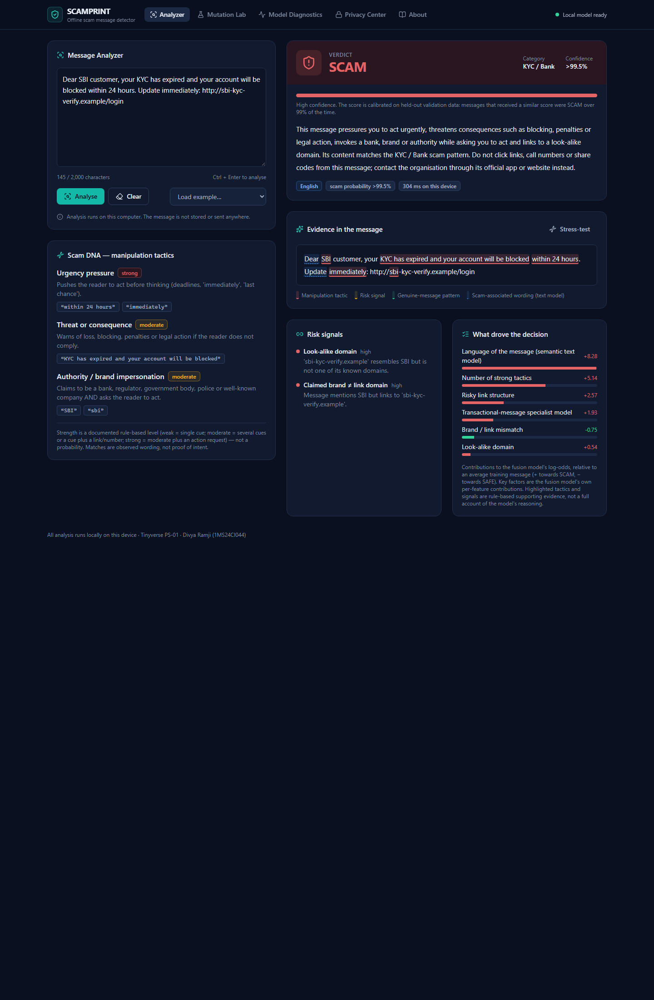

# SCAMPRINT

**An explainable, privacy-first, adversarially robust on-device scam message detector.**
Tinyverse — Problem Statement 01: On-Device Scam Message Detector · Divya Ramji (USN 1MS24CI044)

Paste one SMS or WhatsApp message and SCAMPRINT returns **SCAM / SAFE**, a **scam category**
(KYC / Bank, Lottery / Prize, Loan / Credit, Job / Investment, Other), a **calibrated confidence**, the
**manipulation tactics** it found, structural **risk signals**, and a plain-language **explanation**, all computed
offline on an ordinary laptop CPU.



## What makes it different

* **Detects the manipulation strategy, not just keywords.** The *Scam DNA* engine identifies 10 tactics
  (urgency, threats, impersonation, reward promises, requests for OTP/PIN, payment demands, link pushing,
  job/investment lures, emotional pressure, secrecy) with evidence spans and negation handling.
* **Protects genuine messages.** It recognises OTP, transaction, delivery and reminder shapes and safety advice, and uses a
  specialist model trained only on transactional messages. A conflict detector catches "genuine-looking shell +
  malicious instruction" (e.g. *"send the OTP to our agent"*). There is never an "OTP ⇒ safe" rule.
* **Calibrated confidence.** Out-of-fold stacking and isotonic calibration on held-out data give test ECE 0.007.
  Confidence is always the probability of the *predicted* verdict.
* **Robust to disguise.** Look-alike Unicode, digit swaps (`acc0unt`), spaced letters (`K Y C`), invisible
  characters, SMS abbreviations and Hinglish are normalised, and the original text is preserved for evidence.
* **Mutation Lab.** Stress-test any message with 11 local mutation types and see whether the verdict holds.
* **Provably local.** A socket-level guard blocks every non-loopback connection from the backend, and a live
  Privacy Center shows file hashes, guard state and open sockets.

## Results (untouched test set, n = 3,138; computed by `ml/evaluation/evaluate.py`)

| Metric | Value | | Metric | Value |
|---|---|---|---|---|
| Accuracy | **95.0 %** | | ROC-AUC | 0.988 |
| Precision / Recall | 95.4 % / 93.7 % | | Brier / ECE | 0.038 / 0.007 |
| F1 (scam) | 94.5 % | | Category macro-F1 | 84.9 % |
| **False-positive rate** | **3.9 %** | | Genuine OTPs flagged | 0 / 58 |
| Adversarial (11k mutations) acc. | 94.7 % | | Latency (CPU, p50) | 15.9 ms |
| External Test B acc. / FPR | 88.5 % / 9.5 % | | Model size | 7.9 MB |

The full hybrid lowers the false-positive rate from 4.6 % (text model alone) to 3.9 % at equal F1. On the harder
external Test B it does **not** beat simpler variants on F1 (see `reports/evaluation_report.md`). The limitations
below matter: much of the genuine-service and Hinglish data is synthetic.

## Quick start (Windows PowerShell)

```powershell
.\setup.ps1          # one time: venv + pip install + npm install + UI build (uses the trained model)
.\run.ps1            # start offline -> open http://127.0.0.1:8000
.\test.ps1           # 111 automated tests + UI offline-asset scan
```
Retrain everything from the public data (needs internet once, ~12 min on CPU): `.\setup.ps1 -Train` or
`.\scripts\train_all.ps1`. Development UI with hot reload: `.\run.ps1 -Dev` → http://127.0.0.1:5173.

Requirements: Python 3.12, Node.js 20+ (tested with 24), no GPU. Manual equivalent:
```powershell
python -m venv .venv; .\.venv\Scripts\pip install -r requirements.txt
cd frontend; npm install; npm run build; cd ..
.\.venv\Scripts\python -m backend.main
```

## Offline use
After setup no network is needed. Disable Wi-Fi, run `.\run.ps1`, analyse messages, and use **Privacy Center →
Run offline prediction test**. Details and the full verification procedure: [docs/PRIVACY.md](docs/PRIVACY.md).

## Architecture

```
text ─► preprocessing (de-obfuscation, Hinglish glosses, entity extraction, offset map)
     ─► Scam DNA tactics │ trust & risk signals │ genuine-message protection     (rule engines)
     ─► semantic TF-IDF LR │ transactional specialist LR                        (statistical)
     ─► calibrated fusion LR ─► verdict + confidence ─► category LR ─► explainer
```
FastAPI (127.0.0.1) serves both the API and the React/TypeScript/Tailwind UI. See
[docs/ARCHITECTURE.md](docs/ARCHITECTURE.md).

**Stack:** Python 3.12 · scikit-learn · FastAPI · Uvicorn · React 19 · TypeScript · Vite · Tailwind CSS 4 · Lucide.

## Repository map
| Path | Contents |
|---|---|
| `backend/` | API, preprocessing, engines, explainer, mutations, privacy guard |
| `ml/` | data preparation, augmentation, training, evaluation; `artifacts/` holds the model |
| `frontend/` | React UI (Analyzer, Mutation Lab, Model Diagnostics, Privacy Center, About) |
| `tests/` | unit, integration, privacy, adversarial, performance |
| `reports/` | generated metrics, evaluation/dataset reports, figures, error analysis |
| `docs/` | architecture, datasets, model card, privacy, testing, demo guide/script, screenshots |
| `TECHNICAL_REPORT.md` | full write-up |

## Limitations
* 41 % of the data is LLM-generated; genuine *service* messages (OTP, bank, delivery) are almost all synthetic,
  so real-world false-positive rates may differ.
* Hinglish / Hindi / regional data is small (~1.3k rows) and synthetic; per-language metrics are indicative.
* Some scam category labels come from keyword rules (excluded from category evaluation).
* Link analysis is lexical with a small hand-made official-domain list; compromised legitimate sites are not detected.
* No transformer model was evaluated (would require a large download; see `KNOWN_ISSUES.md`).
* Scams evolve, so the model needs periodic retraining. It supports a decision; it does not replace verification.

## Documentation
[Technical report](TECHNICAL_REPORT.md) · [Model card](docs/MODEL_CARD.md) · [Datasets](docs/DATASETS.md) ·
[Privacy](docs/PRIVACY.md) · [Testing](docs/TESTING.md) · [Demo guide](docs/DEMO_GUIDE.md) ·
[Demo script](docs/DEMO_SCRIPT.md) · [Decisions](DECISIONS.md) · [Known issues](KNOWN_ISSUES.md)

## Data credits
UCI SMS Spam Collection (Almeida & Hidalgo); Scam Shield SMS (rasheq) incl. IMC 2025 smishing reports
(Agarwal, Papasavva, Suarez-Tangil, Vasek) and Mishra & Soni SMS Phishing Dataset; Indian Scam SMS
synthetic-audited (Ridham115). All CC BY 4.0.
