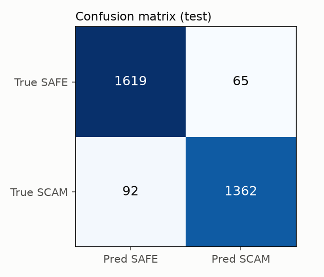
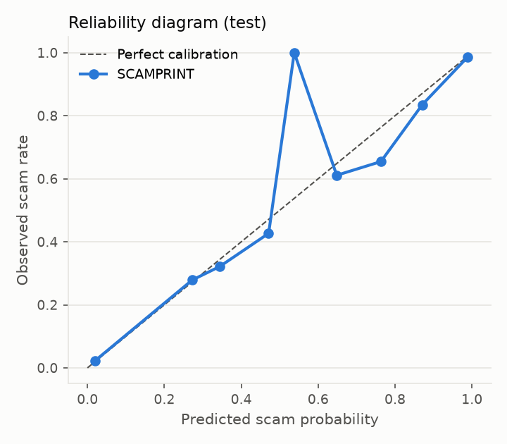
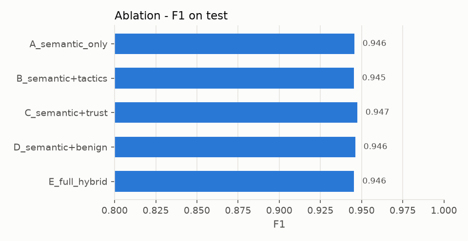
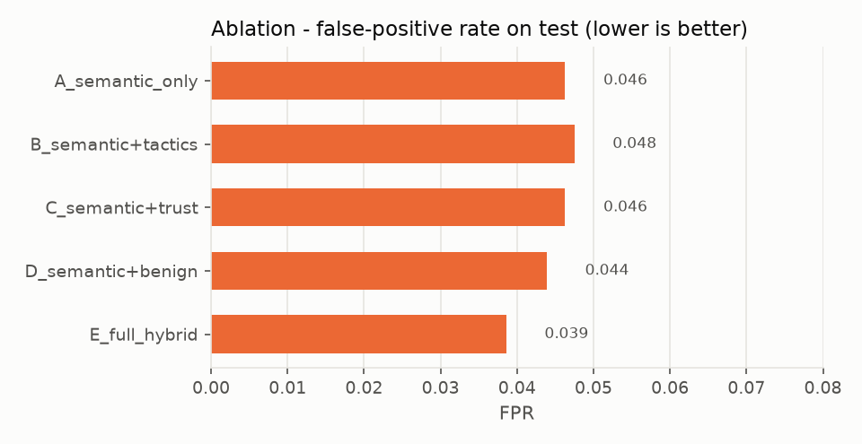
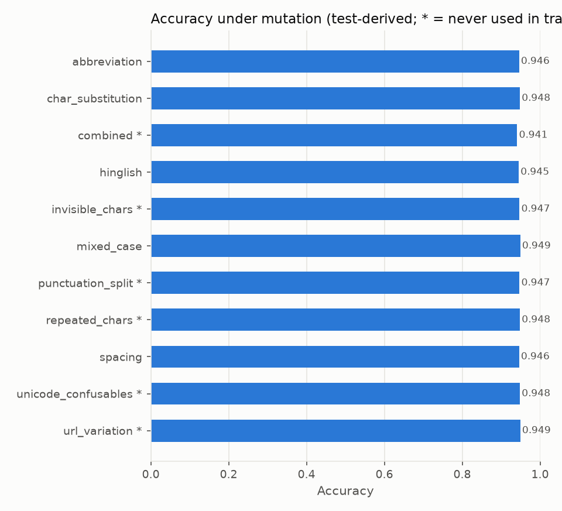

# Evaluation report

_Generated 2026-11-23 03:14:37 by `ml/evaluation/evaluate.py` from the saved bundle; every number is computed from actual predictions._

Decision threshold on calibrated scam probability: **0.5**

## Headline
| set | n | accuracy | precision | recall | f1 | macro_f1 | false_positive_rate | false_negative_rate | roc_auc | brier | ece_scam_prob |
|---|---|---|---|---|---|---|---|---|---|---|---|
| Test (untouched) | 3138 | 0.9500 | 0.9544 | 0.9367 | 0.9455 | 0.9496 | 0.0386 | 0.0633 | 0.9882 | 0.0382 | 0.0073 |
| External Test B | 400 | 0.8850 | 0.9005 | 0.8643 | 0.8821 | 0.8849 | 0.0945 | 0.1357 | 0.9560 | 0.0790 | 0.0364 |
| Adversarial (all mutations) | 11000 | 0.9467 | 0.9589 | 0.9335 | 0.9460 | 0.9467 | 0.0400 | 0.0665 | 0.9873 | 0.0397 | 0.0093 |

 

## By source (test)
| set | n | accuracy | precision | recall | f1 | macro_f1 | false_positive_rate | false_negative_rate | roc_auc | brier | ece_scam_prob |
|---|---|---|---|---|---|---|---|---|---|---|---|
| indian_synthetic | 237 | 0.9198 | 0.9407 | 0.9024 | 0.9212 | 0.9198 | 0.0614 | 0.0976 | 0.9656 | 0.0681 | 0.0390 |
| scam_shield/imc2025 | 1010 | 0.9535 | 1.0000 | 0.9535 | 0.9762 | 0.4881 | 0.0000 | 0.0465 |  |  |  |
| scam_shield/mishra_soni | 498 | 0.9839 | 0.8378 | 0.9394 | 0.8857 | 0.9385 | 0.0129 | 0.0606 | 0.9952 | 0.0155 | 0.0300 |
| scam_shield/synthetic | 744 | 0.9798 | 0.0000 | 0.0000 | 0.0000 | 0.4949 | 0.0202 | 0.0000 |  |  |  |
| scam_shield/synthetic_v2 | 595 | 0.8857 | 0.8741 | 0.8924 | 0.8832 | 0.8857 | 0.1205 | 0.1076 | 0.9547 | 0.0846 | 0.0433 |
| uci_sms_spam | 54 | 1.0000 | 0.0000 | 0.0000 | 0.0000 | 1.0000 | 0.0000 | 0.0000 |  |  |  |

## By language (test)
| set | n | accuracy | precision | recall | f1 | macro_f1 | false_positive_rate | false_negative_rate | roc_auc | brier | ece_scam_prob |
|---|---|---|---|---|---|---|---|---|---|---|---|
| en | 2945 | 0.9511 | 0.9541 | 0.9386 | 0.9463 | 0.9507 | 0.0383 | 0.0614 | 0.9888 | 0.0368 | 0.0074 |
| hi | 28 | 0.8929 | 0.9333 | 0.8750 | 0.9032 | 0.8916 | 0.0833 | 0.1250 | 0.9505 | 0.0874 | 0.1394 |
| hinglish | 82 | 0.9390 | 0.9268 | 0.9500 | 0.9383 | 0.9390 | 0.0714 | 0.0500 | 0.9815 | 0.0606 | 0.0918 |
| regional_mixed | 83 | 0.9398 | 1.0000 | 0.8913 | 0.9425 | 0.9396 | 0.0000 | 0.1087 | 0.9894 | 0.0474 | 0.0538 |

## Special subsets
Genuine-message subsets report `flagged_as_scam` (= false-positive rate within the subset); scam subsets report `accuracy` (= recall within the subset).

| subset | n | accuracy | flagged_as_scam |
|---|---|---|---|
| genuine_otp | 58 | 1.0 | 0.0 |
| genuine_bank_notifications | 146 | 0.9452 | 0.0548 |
| genuine_delivery_notifications | 176 | 0.9716 | 0.0284 |
| genuine_with_links | 459 | 0.9455 | 0.0545 |
| genuine_personal_chat | 519 | 0.9884 | 0.0116 |
| scam_kyc_bank | 496 | 0.9677 | 0.9677 |
| scam_loan_credit | 24 | 0.875 | 0.875 |
| scam_lottery_prize | 53 | 0.9245 | 0.9245 |
| scam_job_investment | 37 | 0.7838 | 0.7838 |
| scam_other | 535 | 0.9346 | 0.9346 |
| lang_en | 2945 | 0.9511 | FPR 0.0383 / recall 0.9386 |
| lang_hinglish | 82 | 0.939 | FPR 0.0714 / recall 0.95 |
| lang_hi | 28 | 0.8929 | FPR 0.0833 / recall 0.875 |
| lang_regional_mixed | 83 | 0.9398 | FPR 0.0 / recall 0.8913 |
| borderline_test_b_hard | 118 | 0.7712 | FPR 0.2105 / recall 0.7541 |

## Scam categories (gold-labelled test scams)
n = 1145, macro-F1 = **0.8493**, accuracy = 0.8908; SAFE predictions carrying a category: 0

| category | precision | recall | f1 | support |
|---|---|---|---|---|
| KYC_BANK | 0.921 | 0.8931 | 0.9069 | 496 |
| LOTTERY_PRIZE | 0.8261 | 0.717 | 0.7677 | 53 |
| LOAN_CREDIT | 0.8846 | 0.9583 | 0.92 | 24 |
| JOB_INVESTMENT | 0.8621 | 0.6757 | 0.7576 | 37 |
| OTHER | 0.8721 | 0.9178 | 0.8944 | 535 |

Confusion matrix (rows = true, cols = predicted): KYC_BANK, LOTTERY_PRIZE, LOAN_CREDIT, JOB_INVESTMENT, OTHER
```
[443, 2, 3, 2, 46]
[0, 38, 0, 0, 15]
[0, 0, 23, 0, 1]
[2, 0, 0, 25, 10]
[36, 6, 0, 2, 491]
```

## Ablation (threshold 0.5, each variant calibrated on val)
| variant | test F1 | test FPR | test recall | test AUC | test ECE | Test B F1 | Test B FPR | adversarial F1 |
|---|---|---|---|---|---|---|---|---|
| A_semantic_only | 0.9456 | 0.0463 | 0.945 | 0.9889 | 0.0059 | 0.9 | 0.1045 | 0.9434 |
| B_semantic+tactics | 0.9453 | 0.0475 | 0.9457 | 0.9889 | 0.0078 | 0.9073 | 0.0945 | 0.9427 |
| C_semantic+trust | 0.9474 | 0.0463 | 0.9484 | 0.9888 | 0.0091 | 0.895 | 0.1095 | 0.9471 |
| D_semantic+benign | 0.9462 | 0.0439 | 0.9436 | 0.9892 | 0.0076 | 0.8939 | 0.0995 | 0.9421 |
| E_full_hybrid | 0.9455 | 0.0386 | 0.9367 | 0.9882 | 0.0073 | 0.8821 | 0.0945 | 0.9439 |

 

## Adversarial robustness (mutations of test messages; * held out from training augmentation)
| mutation | held out | n | text changed | scam recall | safe specificity | accuracy | verdict flip rate |
|---|---|---|---|---|---|---|---|
| (unmutated) | | 1000 | | 0.932 | 0.962 | | |
| abbreviation |  | 1000 | 0.845 | 0.924 | 0.968 | 0.946 | 0.011 |
| char_substitution |  | 1000 | 0.998 | 0.934 | 0.962 | 0.948 | 0.001 |
| combined | * | 1000 | 0.999 | 0.944 | 0.938 | 0.941 | 0.03 |
| hinglish |  | 1000 | 0.755 | 0.928 | 0.962 | 0.945 | 0.006 |
| invisible_chars | * | 1000 | 0.999 | 0.932 | 0.962 | 0.947 | 0.0 |
| mixed_case |  | 1000 | 0.999 | 0.952 | 0.946 | 0.949 | 0.022 |
| punctuation_split | * | 1000 | 0.999 | 0.93 | 0.964 | 0.947 | 0.004 |
| repeated_chars | * | 1000 | 1.0 | 0.928 | 0.968 | 0.948 | 0.007 |
| spacing |  | 1000 | 0.999 | 0.928 | 0.964 | 0.946 | 0.003 |
| unicode_confusables | * | 1000 | 0.968 | 0.932 | 0.964 | 0.948 | 0.001 |
| url_variation | * | 1000 | 0.043 | 0.936 | 0.962 | 0.949 | 0.002 |



## Performance (CPU)
```
{
  "model_load_seconds": 2.481,
  "bundle_size_mb": 7.93,
  "rss_increase_after_load_mb": 124.4,
  "process_rss_mb": 514.8,
  "single_predict_ms": {
    "mean": 17.47,
    "p50": 15.86,
    "p95": 29.89,
    "max": 47.15
  },
  "batch_ms_per_message": 3.258,
  "device": "CPU only",
  "cpu": "13th Gen Intel Core i7-1355U (measured machine)"
}
```

Errors on test: {'false_positives': 65, 'false_negatives': 92} - see `error_analysis.md`.